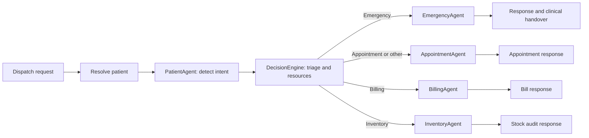

# Hospital Operations AI Agent

A local development project for hospital operations: a React console backed by a FastAPI service, an async SQLAlchemy database, and a LangGraph workflow that dispatches requests to specialized agents.

> **Prototype notice:** This project is for development and demonstration, not for clinical use or real patient care. AI-generated triage, recommendations, summaries, and billing estimates are not medical or financial advice. Do not enter real patient information unless your environment and handling practices have been approved for it. Patient registry matching is not identity verification.

## What it does

- Registers or finds a patient record, then dispatches a natural-language request.
- Classifies intent and evaluates triage alongside bed availability, medicine forecasts, and on-duty physicians.
- Routes the request to appointment, emergency, billing, or inventory handling.
- Provides a React console for intake and operational views of beds, doctors, and pharmacy inventory.
- Exposes service endpoints and interactive API documentation through FastAPI.

## Requirements

- Python 3.10 or newer
- Node.js 20.19+ (or 22.12+) and npm
- A Groq API key and a model name available to your Groq account for LLM-backed flows

The default database is SQLite, so no separate database server is needed for local development.

## Quick start

Run the backend and frontend in separate terminals from the repository root.

### 1. Configure the backend

Create and activate a virtual environment, then install the Python packages:

```bash
python3 -m venv .venv
source .venv/bin/activate
python -m pip install --upgrade pip
pip install -r requirements.txt
```

Create a `.env` file in the repository root:

```dotenv
GROQ_API_KEY=your_groq_api_key
LLM_MODEL=your_groq_model_name
DATABASE_URL=sqlite+aiosqlite:///./data/hospital.db
SQL_ECHO=false
```

`GROQ_API_KEY` and `LLM_MODEL` are required for agent dispatch and triage requests. `DATABASE_URL` and `SQL_ECHO` show the defaults; they can be omitted. `OPENAI_API_KEY` exists in settings but is not currently used by the LLM client. Keep `.env` private and never commit API keys.

### 2. Initialize and seed local data

From the repository root, run:

```bash
python seed.py
```

The API also creates missing tables at startup. Seeding adds sample doctors, beds, medicines, and a patient; it is safe to run repeatedly and does not overwrite existing seed records.

### 3. Start the API

```bash
uvicorn src.main:app --reload
```

The API is available at `http://localhost:8000`. Check `http://localhost:8000/health` for a health response, or open `http://localhost:8000/docs` for Swagger UI. ReDoc is at `http://localhost:8000/redoc`.

### 4. Start the frontend

In a second terminal:

```bash
cd frontend
npm ci
npm run dev
```

Open the local URL printed by Vite (usually `http://localhost:5173`). The frontend calls `http://localhost:8000/api/v1` by default. To use a different API base URL, create `frontend/.env.local` with:

```dotenv
VITE_API_BASE_URL=http://localhost:8000/api/v1
```

Restart Vite after changing environment variables. The API currently enables CORS for all origins for development; configure allowed origins before deploying.

## Configuration

Backend settings are read from environment variables or the root `.env` file in [src/config.py](src/config.py).

| Setting | Default | Purpose |
| --- | --- | --- |
| `GROQ_API_KEY` | Empty | API key used by the Groq chat model |
| `LLM_MODEL` | Empty | Groq model identifier |
| `DATABASE_URL` | `sqlite+aiosqlite:///./data/hospital.db` | Async SQLAlchemy database URL |
| `SQL_ECHO` | `false` | Echo database statements to logs |
| `PORT` | `8000` | Application setting; Uvicorn's CLI port is controlled with `--port` |
| `DEBUG` | `true` | Application setting |
| `VITE_API_BASE_URL` | `http://localhost:8000/api/v1` | Frontend API base URL; set in `frontend/.env.local` |

The default SQLite file is `data/hospital.db`, relative to the backend working directory. Stop the API before manually deleting or replacing the database file. Then run `python seed.py` to create tables and restore sample data.

## How a request is handled

The main workflow is assembled in [src/orchestrator/workflow.py](src/orchestrator/workflow.py) and invoked by `POST /api/v1/dispatch`.



The workflow calls the decision engine for each dispatch, then routes based on detected intent. `EMERGENCY`, `BILLING`, and `INVENTORY` have dedicated routes; other intents go to appointments. The decision engine uses the emergency service's triage result, current bed counts, medicine shortage predictions, and available doctors to produce an evaluation. It does not itself guarantee that resources are reserved; the selected agent performs its own operation where applicable.

## Agents and orchestration

| Component | Responsibility |
| --- | --- |
| `PatientAgent` | Uses structured LLM output to detect `EMERGENCY`, `APPOINTMENT`, `BILLING`, or `INVENTORY` intent and extract symptoms. On parsing failure it defaults to emergency routing. |
| `EmergencyAgent` | Runs triage, attempts bed allocation for ESI levels 1-3, records a consultation, and returns a patient summary and clinical handover. |
| `AppointmentAgent` | Finds an on-duty doctor, attempts to schedule a slot, records the consultation, and returns a confirmation. |
| `BillingAgent` | Creates a bill using the project's fixed prototype rate card and returns a generated explanation. |
| `InventoryAgent` | Audits predicted stock-out timelines and asks the LLM for an operational summary. |
| `DecisionEngine` | Combines triage, bed capacity, stock alerts, and physician availability into a decision result. |
| `hospital_graph` | LangGraph state machine: intake, decision evaluation, then one intent-selected agent. |

Shared LLM construction is in [src/core/llm.py](src/core/llm.py); agents use [src/agents/base.py](src/agents/base.py) for prompts and responses. Agent and triage output is generated text and must be reviewed by qualified staff in any evaluation setting.

## Services

Services contain the database-facing operations used by both routes and agents.

| Service | Responsibility |
| --- | --- |
| `PatientService` | Matches or creates registry records, records consultations, and retrieves patient history. Matching requires phone, email, and a partial name match. |
| `EmergencyService` | Requests structured ESI-style triage output from the configured LLM; a parsing failure returns a high-alert fallback. |
| `BedService` | Counts beds, allocates available beds, and releases beds. |
| `DoctorService` | Reads doctor rosters, filters on-duty doctors, changes availability, and schedules appointments with conflict checks. |
| `InventoryService` | Estimates days of stock remaining and records stock changes with reasons; adjustments that would make stock negative are rejected. |

Database models and response schemas live in [src/models](src/models). The async database engine, session dependency, and table initialization are in [src/core/database.py](src/core/database.py).

## API overview

All application routes are prefixed with `/api/v1`. The full request schemas and responses are available at `/docs`.

| Method | Path | Purpose |
| --- | --- | --- |
| `POST` | `/dispatch` | Resolve patient and run the multi-agent workflow |
| `POST` | `/patients/register` | Register or find a patient |
| `GET` | `/patients/{identifier}/history` | Fetch history by patient ID or MRN |
| `POST` | `/emergency/triage-eval` | Evaluate symptoms and vitals |
| `GET` | `/beds/breakdown` | Bed counts by type and status |
| `POST` | `/beds/allocate` | Allocate a bed to a patient |
| `POST` | `/beds/release/{bed_id}` | Release a bed |
| `GET` | `/doctors/roster` | List doctors, optionally filtered by specialty |
| `POST` | `/doctors/schedule` | Schedule a doctor and patient appointment |
| `GET` | `/inventory/predict-shortages` | Forecast medicine shortages |
| `POST` | `/inventory/restock` | Record a medicine receipt |
| `POST` | `/inventory/adjustments` | Record a stock change with a reason |
| `GET` | `/admin/beds` | Detailed bed roster for the console |
| `PATCH` | `/admin/doctors/{doctor_id}/availability` | Change a doctor's on-duty status |
| `GET` | `/admin/inventory/transactions` | List recent inventory adjustments |

## Development checks

Frontend production build and lint:

```bash
cd frontend
npm run build
npm run lint
```

The root `test_*.py` files are standalone scripts, not a configured pytest suite. Several exercise live LLM calls and mutate the local database, so review their inputs and seed the database before running them. They are not isolated unit tests.

## Project layout

```text
src/
	agents/          LLM-backed patient, emergency, appointment, billing, inventory agents
	api/             FastAPI route definitions
	core/            Settings, database, LLM client, and logging
	models/          SQLAlchemy models and Pydantic schemas
	orchestrator/    Decision engine and LangGraph workflow
	services/        Patient, emergency, bed, doctor, and inventory operations
frontend/          React + Vite hospital operations console
seed.py            Idempotent local sample-data seeder
```

## Operational notes

- Registry matching is a convenience lookup, not SMS/OTP verification or proof of identity. Staff must follow their normal verification process.
- `PatientAgent` and `EmergencyService` have fallback outputs when LLM parsing fails, but these fallbacks do not make the application suitable for real-world triage.
- Billing uses an in-code rate card and a default 80% insurance coverage assumption; it is demonstration logic, not an actual quote or claim calculation.
- Before any deployment, add authentication and authorization, restrict CORS, review data protection and retention, secure secrets, and validate all clinical and financial workflows with qualified owners.